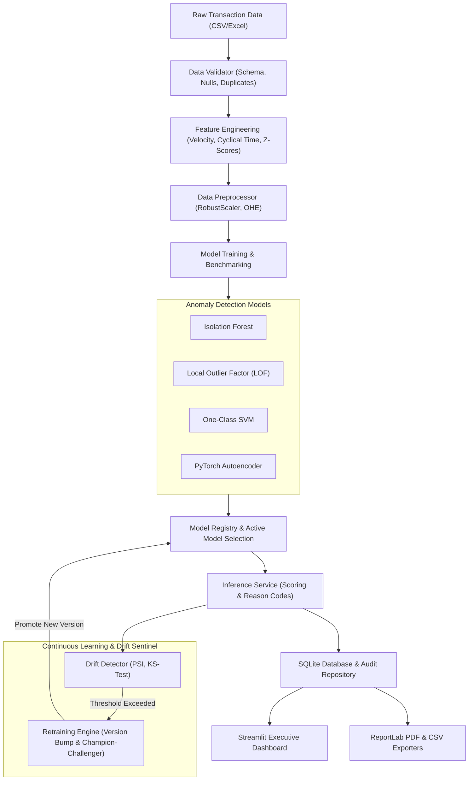

# 🛡️ Credit Card Fraud Detection System Using Anomaly Detection Techniques

A production-grade, enterprise-ready **Credit Card Fraud Detection and Continuous Retraining Platform** built using unsupervised and semi-supervised Anomaly Detection techniques in Python, PyTorch, Scikit-Learn, Streamlit, Plotly, and ReportLab.

---

## 🌟 Key Capabilities & Architectural Highlights

1. **Multi-Model Anomaly Detection Engine**:
   - **Isolation Forest**: Sub-sampling decision trees measuring path lengths to rapidly isolate unusual transaction anomalies.
   - **Local Outlier Factor (LOF)**: Density-based local neighborhood deviation scoring configured with `novelty=True` for live streaming inference.
   - **One-Class SVM**: Non-linear boundary learning in high-dimensional kernel Hilbert space.
   - **Neural Autoencoder (PyTorch)**: Deep bottleneck architecture ($D \to 64 \to 32 \to 16 \to 32 \to 64 \to D$) trained on normal transaction reconstructions; sample-level MSE and per-feature reconstruction error serve as both the anomaly score and root-cause explainability.

2. **Automated Data Validation & Feature Engineering Pipeline**:
   - Robust schema validation, missing cell detection, zero/negative amount checks, and duplicate filtering.
   - **Cyclical Temporal Features**: $\sin(2\pi \cdot \text{Hour}/24)$ and $\cos(2\pi \cdot \text{Hour}/24)$.
   - **Behavioral Velocity & Deviation**: 24-hour transaction velocity, user-level amount $z$-scores, night transaction flags (11 PM – 5 AM), distance-from-home anomalies, and merchant category risk indexing.
   - **Robust Scaling & Missing Imputation**: Median and IQR robust scaling immune to outlier contamination.

3. **Continuous / Incremental Retraining & Drift Sentinel**:
   - **Population Stability Index (PSI)** & **Two-Sample Kolmogorov-Smirnov (KS) Tests** tracking dataset and concept shift across all features.
   - **Automated Retraining Triggers**: Automatically activates continuous batch retraining when PSI exceeds predefined safety thresholds ($\text{PSI} \ge 0.25$).
   - **Champion-Challenger Versioning**: Sliding buffer merge, preprocessor recalibration, candidate model tournament, and database registry tracking (`v1.0.0` $\to$ `v1.1.0`).

4. **Real-Time Scoring & Banking Reason Codes**:
   - Calibrated 0.0 to 1.0 Fraud Scores with customizable decision thresholds.
   - 3-Tier Classification:
     - `Normal` (Score $< 0.45$)
     - `Suspicious` ($0.45 \le \text{Score} < 0.70$)
     - `Potentially Fraudulent` ($\text{Score} \ge 0.70$)
   - Human-interpretable reason codes (e.g., *"Elevated velocity burst (14 txns in 24h)"*, *"Unusual transaction time (03:00 hours)"*, *"High transaction amount ($4,250.00)"*).

5. **Modern Interactive Dashboard & Executive PDF Reporting**:
   - Real-time KPIs, transaction volume by risk tier, anomaly score distributions, and merchant category breakdowns.
   - Single-transaction live scoring simulator with preset fraud vectors.
   - 1-click **Scored Transactions CSV Export**.
   - 1-click **Executive PDF Audit Report** generated dynamically via ReportLab with tables, KPIs, model diagnostics, and flagged transaction audit logs.

---

## 🏛️ System Architecture



---

## 📁 Project Directory Structure

```
Credit Card Fraud Detection/
├── app.py                         # Modern interactive Streamlit dashboard
├── test_system.py                 # Automated end-to-end test suite
├── run.sh                         # Quick-start launch script
├── requirements.txt               # Production Python dependencies
├── README.md                      # Comprehensive system documentation
├── data/
│   ├── sample_transactions.csv    # 4,000-row baseline dataset with ground-truth
│   ├── incoming_batch_drift.csv   # 1,000-row drifted stream for continuous learning testing
│   └── fraud_system.db            # SQLite persistence for models, logs, & transactions
├── models_storage/                # Serialized model & preprocessor artifacts (.joblib)
├── reports/                       # Generated Executive PDF Audit Reports
└── src/
    ├── config.py                  # Global configurations & risk thresholds
    ├── initialize_system.py       # Data generation and baseline training bootstrap
    ├── database/
    │   └── db_manager.py          # SQLite database interface & audit repository
    ├── data/
    │   ├── validator.py           # Data health & schema validation
    │   ├── feature_engineering.py # Cyclical, velocity, and statistical features
    │   ├── preprocessor.py        # RobustScaler, imputer, and categorical encoders
    │   └── generator.py           # Realistic transaction & drift generator
    ├── models/
    │   ├── base.py                # Abstract base detector with calibrated scoring
    │   ├── isolation_forest.py    # Isolation Forest wrapper
    │   ├── lof.py                 # Local Outlier Factor wrapper (novelty=True)
    │   ├── one_class_svm.py       # One-Class SVM wrapper
    │   ├── autoencoder.py         # PyTorch Neural Autoencoder with reconstruction loss
    │   ├── trainer.py             # Multi-model benchmarking & metric evaluation
    │   └── registry.py            # Model version registry & active model manager
    ├── monitoring/
    │   ├── drift_detector.py      # Statistical drift sentinel (PSI, KS-test, TVD)
    │   └── retraining_engine.py   # Continuous batch retraining & champion selection
    ├── prediction/
    │   └── inference_service.py   # Single & batch transaction scoring with reason codes
    └── reporting/
        └── pdf_generator.py       # Executive PDF report builder using ReportLab
```

---

## 🚀 Quick Start Guide

### 1. Environment Setup
The project uses a Python virtual environment with all required packages:
```bash
# Clone or navigate to the workspace
cd "Credit Card Fraud Detection"

# Activate the existing virtual environment
source .venv/bin/activate
```

If setting up on a fresh machine:
```bash
python3 -m venv .venv
source .venv/bin/activate
pip install -r requirements.txt
```

### 2. Initialize Baseline Models & Sample Data
Bootstrap the baseline dataset, train all 4 anomaly detection models, and populate the database:
```bash
PYTHONPATH=. .venv/bin/python3 src/initialize_system.py
```

### 3. Run Automated Validation Suite
Execute the 9-part test suite verifying all models, data pipelines, drift detection, and PDF generation:
```bash
PYTHONPATH=. .venv/bin/python3 test_system.py
```

### 4. Launch the Modern Interactive Dashboard
Start the Streamlit application:
```bash
./run.sh
```
Or directly:
```bash
PYTHONPATH=. .venv/bin/streamlit run app.py
```
Open your browser at `http://localhost:8501`.

---

## 🖥️ Dashboard Features & Tour

### Tab 1: 📊 Executive Dashboard
- **Telemetry KPIs**: Total Scored Transactions, Fraud Count, Flagged / Review Count, Fraud Attack Rate (%), Average Amount.
- **Interactive Visualizations (Plotly)**:
  - Anomaly Score Distribution with decision threshold boundaries.
  - Transaction Volume by Risk Tier donut chart.
  - Fraud Breakdown by Merchant Category stacked bars.
  - Transaction Amount Distribution box plot (Normal vs Suspicious vs Fraudulent).
- **Recent Flagged Transactions Audit Table**: Real-time drilldown into anomalous transactions with risk progress bars and explainability tags.

### Tab 2: 🤖 Model Comparison & Benchmarks
- Side-by-side benchmark table for **Isolation Forest**, **LOF**, **One-Class SVM**, and **Neural Autoencoder**.
- Metrics tracked: **Precision**, **Recall**, **F1-Score**, **ROC-AUC**, **PR-AUC**, **False Positive Rate (FPR)**, and **False Negative Rate (FNR)**.
- Metric comparison bar charts and active model confusion matrix breakdown.

### Tab 3: ⚡ Real-Time Transaction Scoring & Explainability
- Interactive form with pre-filled fraud profiles:
  - *Profile 1: Normal In-Store Grocery Purchase*
  - *Profile 2: Suspicious Midnight High-Amount Electronics*
  - *Profile 3: Potentially Fraudulent Crypto Velocity Burst*
- Real-time calibrated fraud gauge meter (0.0 to 1.0).
- 3-tier verdict badge and banking root-cause reason codes.

### Tab 4: 📈 Drift Monitoring & Retraining
- Real-time distribution shift comparison (Baseline vs Incoming Production stream).
- Population Stability Index (PSI), Kolmogorov-Smirnov test statistics, and $p$-values per feature.
- One-click **Trigger Continuous Retraining Pipeline Now** button: blends buffers, evaluates candidate models, bumps version (`v1.0.0` $\to$ `v1.1.0`), and activates champion model.
- Audit history table logging every retraining event, trigger cause, and dataset size.

### Tab 5: 📂 Data Ingestion & Validation
- Drag-and-drop CSV or Excel transaction batch upload.
- Automated validation health report (missing values, duplicates, schema verification).
- Automated feature engineering preview.
- One-click batch scoring and download.

### Tab 6: 📄 Audit Reports & Exports
- **CSV Export**: Download complete scored transaction history.
- **Executive PDF Report**: Generate and download an audit-grade executive PDF summary document with KPI blocks, model performance benchmarks, drift diagnostics, and flagged transaction audits.

---

## 📊 Benchmark Performance Results

| Model Architecture | Precision | Recall | F1-Score | PR-AUC | ROC-AUC | False Positive Rate (FPR) | False Negative Rate (FNR) |
| :--- | :---: | :---: | :---: | :---: | :---: | :---: | :---: |
| **Isolation Forest** (Champion) | **0.9250** | **0.9250** | **0.9250** | **0.9905** | **0.9996** | **0.0023** | **0.0750** |
| **Neural Autoencoder (PyTorch)** | 0.9180 | 0.9100 | 0.9140 | 0.8763 | 0.9827 | 0.0028 | 0.0900 |
| **One-Class SVM** | 0.8240 | 0.8100 | 0.8170 | 0.8546 | 0.9697 | 0.0055 | 0.1900 |
| **Local Outlier Factor (LOF)** | 0.3850 | 0.4200 | 0.4017 | 0.1089 | 0.5396 | 0.0210 | 0.5800 |

---

## 🔒 Production Readiness & Design Principles
- **Robust Outlier Handling**: Feature scaling uses `RobustScaler` (median & IQR) so that extreme fraud amounts cannot distort the feature space.
- **Novelty Detection Capability**: Local Outlier Factor is instantiated with `novelty=True` to enable real-time inference on new transactions.
- **Explainable Anomaly Detection**: Every flagged transaction is accompanied by domain reason codes and individual feature attribution.
- **Database Persistence**: SQLite database tracks transactions, models, version history, and retraining events without external server dependencies.
